# Phase 4 Task 3 — Full Product Integration Audit & Standalone Application Readiness

**Platform:** Enterprise-Grade Autonomous Penetration Testing Platform  
**Target Environment:** Contained Practice Lab (`http://127.0.0.1:3000`) & Bifrost Gateway (`http://127.0.0.1:8080`)  
**Authorization Authority:** Authorization Manager (`http://127.0.0.1:3011/api/auth`)  
**Report Identifier:** `AUDIT-PHASE4-TASK3-PRODUCT-001`  
**Date:** November 6, 2026  

---

## 1. Executive Summary

This audit establishes the product readiness, integration integrity, and architectural separation path for our **Enterprise-Grade Autonomous Penetration Testing Platform**.

### 1.1 Key Architecture Premise
Our final product is an **independent, standalone security web application**.
- **Bifrost is strictly an internal, private LLM gateway** running as a local sidecar daemon. Users must never access or view the Bifrost dashboard.
- Our application must own its **frontend, backend API, user authentication, multi-tenant workspace isolation, authorization management, assessment orchestration, findings ledger, audit trail, and compliance reporting**.
- All existing production-grade modules (`core/authmanager`, `core/scopepolicy`, `core/labmanager`, `core/assessment`, `core/cmd/mocksecurityserver`, `core/cmd/mockwebapp`, and the frontend UI) will be preserved and reused.

### 1.2 Summary of Findings
1. **Frontend Implementation**: The existing 5-section UI ([`ui/app/workspace/security-assessment/page.tsx`](file:///c:/Users/krish/Downloads/hacathon/bifrost-dev/bifrost-dev/ui/app/workspace/security-assessment/page.tsx)) is fully implemented, feature-rich, and actively connects to real backend APIs via RTK Query ([`ui/lib/store/apis/securityAssessmentApi.ts`](file:///c:/Users/krish/Downloads/hacathon/bifrost-dev/bifrost-dev/ui/lib/store/apis/securityAssessmentApi.ts)). No placeholder mock data was found; all cards, tables, and forms render real live data.
2. **Backend APIs**: All 14 endpoints required by the frontend are implemented in Go ([`transports/bifrost-http/handlers/lab.go`](file:///c:/Users/krish/Downloads/hacathon/bifrost-dev/bifrost-dev/transports/bifrost-http/handlers/lab.go)) with strict caller identity binding, tenant isolation, and two-person authorization checks.
3. **Workflow Verification**: Both Practice Lab and External Target workflows were traced and tested against our live local environment. Two-person rule enforcement was verified live: self-approval attempts are blocked with HTTP 403 Forbidden.
4. **Test Counts Reconciled**: Clarified that prior regression suites totaled 43 tests; with the 8 new Path Traversal tests, the platform now maintains **51 total verified test scenarios** across 6 suites (100% pass rate).
5. **Report Inconsistencies Resolved**: Verified why XSS was listed as `UNDER_INVESTIGATION` in the previous autonomous run (API rate-limit interrupted turn 5 while findings 1–3 were committed), and verified that Path Traversal proves disclosure of the lab canary token (`TRAVERSAL_CANARY_VERIFIED_98432_SAFE_DISCLOSURE`) with zero host filesystem escape.

```mermaid
flowchart TD
    subgraph PRESENT["Current Integrated Architecture"]
        BIF_UI["Bifrost Dashboard UI (:8080)"] -->|"hosts /workspace/security-assessment"| SEC_UI["Security Assessment UI (page.tsx)"]
        SEC_UI -->|RTK Query| BIF_HTTP["Bifrost HTTP Transport (:8080)"]
        BIF_HTTP -->|lab.go handlers| CORE["Core Engines (authmanager, labmanager, assessment)"]
        CORE -->|subprocess| RUNNER["Production Strix Runner"]
        RUNNER -->|OpenAI SDK /v1| BIF_GW["Bifrost LLM Gateway (:8080)"]
        RUNNER -->|MCP :8080/mcp| BIF_MCP["Bifrost MCP Proxy / ScopeEnforcer"]
        BIF_MCP -->|forward| SEC_MCP["Controlled Security MCP Server (:3011)"]
    end

    subgraph TARGET["Standalone Target Architecture"]
        USER["Security Engineer / Operator"] -->|HTTP :3000| STAND_UI["Standalone Pentest Dashboard (Our Web App)"]
        STAND_UI -->|REST /api/v1| STAND_API["Standalone Go Backend Service (:8000)"]
        STAND_API --> STAND_AUTH["Session & Multi-Tenant Org Manager"]
        STAND_API --> CORE_REUSED["Reused Core Modules (authmanager, labmanager, assessment)"]
        STAND_API --> SE_REUSED["Reused ScopeEnforcer Engine"]
        STAND_API --> SEC_MCP_DIRECT["Controlled Security MCP Server (:3011)"]
        CORE_REUSED --> RUNNER_REUSED["Production Strix Runner"]
        RUNNER_REUSED -->|Internal Loopback Only| BIF_SIDECAR["Private Bifrost Gateway (Headless Sidecar :8080)"]
    end
```



---

## 2. Existing Frontend Architecture Audit

### 2.1 Component Structure & Routing
- **Page Component:** [`ui/app/workspace/security-assessment/page.tsx`](file:///c:/Users/krish/Downloads/hacathon/bifrost-dev/bifrost-dev/ui/app/workspace/security-assessment/page.tsx) (1,420 lines, 55 KB).
- **Route Definition:** [`ui/app/workspace/security-assessment/layout.tsx`](file:///c:/Users/krish/Downloads/hacathon/bifrost-dev/bifrost-dev/ui/app/workspace/security-assessment/layout.tsx) registered in TanStack Router at `/workspace/security-assessment`.
- **API Store Integration:** [`ui/lib/store/apis/securityAssessmentApi.ts`](file:///c:/Users/krish/Downloads/hacathon/bifrost-dev/bifrost-dev/ui/lib/store/apis/securityAssessmentApi.ts) (325 lines) defining 14 RTK Query hooks.

### 2.2 Detailed Audit by Section

#### Section 1: Overview Tab (`activeTab === "overview"`)
- **Components & Layout**:
  - Global Header: Server-validated caller badge (`callerProfile.user_id`, `org_id`, `role`), live pulsator, manual refresh button.
  - Global Alert Banner: Displays operation results and errors (`actionMessage`).
  - Metric Cards Grid (4 cards):
    1. Active Practice Labs count (`managedLabs.filter(status === "running")`).
    2. Active External Authorizations count (`externalGrants.filter(approved && !revoked)`).
    3. Identified Vulnerabilities count (`assessmentResults.findings.length`).
    4. Out-of-Scope Blocks count (`assessmentResults.blocked_requests.length`).
  - Active Target & Scope Card: Target URL with one-click copy, status badge, allowed CIDRs, allowed/blocked paths, allowed methods.
  - Active Running Labs Table: Columns for Lab ID, Target URL, Container ID, Status badge, Expiration time, inline "Run Pentest" and "Stop" actions.
- **Backend APIs Called**: `GET /api/lab/me`, `GET /api/lab/list` (5s poll), `GET /api/auth/external/list` (6s poll), `GET /api/assessment/results` (4s poll).
- **Data Authenticity**: **100% Real Data**. Data is populated dynamically from RTK Query hooks; no hardcoded items exist.
- **State Handling**:
  - Loading states: Loading spinners and pulse indicators during initial fetch.
  - Empty states: "No practice labs currently running. Launch OWASP Juice Shop from the Practice Lab tab."
  - Error states: Global destructive alert displayed if `profileError` is non-null.

#### Section 2: Managed Practice Lab Tab (`activeTab === "practice-lab"`)
- **Components & Layout**:
  - Target Spec Card: Pinned Juice Shop metadata (v20.3.0, sha256:42843723..., 512MB RAM cap, 1.0 CPU quota, WAN Disabled banner).
  - Assessment Window Duration Selector: 30m, 1h, 2h, 4h options.
  - Action Controls: "Launch Practice Lab" button with dynamic state handling (disabled if active lab exists or mutation in-flight).
  - Active Target State Panel: Assigned loopback URL (`http://127.0.0.1:3000`), copy button, external link launcher, metadata grid (Instance ID, Container ID, Port, Expiration), authorization scope table, "Terminate Practice Lab" and "Launch Autonomous Pentest" buttons.
- **Backend APIs Called**: `GET /api/lab/list`, `POST /api/lab/start`, `POST /api/lab/stop`.
- **Data Authenticity**: **Real Data**. Reflects container and port state.
- **State Handling**:
  - Loading states: "Provisioning Container..." spinner on button during `isStartingLab`.
  - Empty states: Detailed guidance box with server icon when no lab is running.
  - Error states: Catches backend error messages (e.g., Docker daemon unavailability or port conflicts) and displays them in the global alert banner.

#### Section 3: External Targets Tab (`activeTab === "external"`)
- **Components & Layout**:
  - Strict Verification Policy Alert: Explains the mandatory two-gate policy (DNS challenge + Owner approval).
  - Target Registration Form: Host input, port input, allowed paths input, blocked paths input, "Register Target for Verification" button.
  - DNS TXT Challenge Card: Appears once registered; displays record type (`TXT`), record name (`_strix-challenge.<host>`), record value (`dns_challenge_token`), copy button, and "Verify DNS Control" button.
  - Formal Approval Card: Active once DNS is verified; inputs for Evidence Reference (e.g. contract or NDA reference) and "Authorize & Activate Assessment" button.
  - External Authorization Grants Table: Columns for Assessment ID, Host, Scope Summary, Status badge, Expiration, inline actions ("Verify DNS", "Approve", "Revoke").
- **Backend APIs Called**: `GET /api/auth/external/list`, `POST /api/auth/external/register`, `POST /api/auth/external/verify-dns`, `POST /api/auth/external/approve`, `POST /api/auth/external/revoke`.
- **Data Authenticity**: **Real Data**. Reflects backend authorization grants database.
- **State Handling**:
  - Loading states: Spinners on all action buttons.
  - Validation: Client-side validation prevents empty host or evidence reference submissions.
  - Two-Person Rule Feedback: Catches backend self-approval rejection and surfaces actionable error text.

#### Section 4: Pentest Results Tab (`activeTab === "results"`)
- **Components & Layout**:
  - Live Assessment Alert Banner: Appears when status is `running` or `starting`; displays target, grant ID, PID, and live "Stop Assessment" button.
  - Report Header Card: Assessment status badge (`COMPLETED`, `RUNNING`, `CANCELLED`), model badge (`gemini/gemini-3.5-flash-lite`), target, grant ID, run ID, re-run button.
  - Metadata Grid: Start time, duration (seconds), tools executed list, scope enforcement blocks count.
  - Executive Summary Card: Renders agent's final markdown summary with `whitespace-pre-wrap`.
  - Confirmed Security Findings Section: Findings counter and cards grouped by severity:
    - Badges: Severity (`Critical` in red, `High` in orange, `Medium` in amber, `Low` in blue), CWE code, verification status (`Confirmed`).
    - Endpoint and parameter labels.
    - Observed Technical Evidence box with monospace formatting.
    - Remediation Recommendation box with estimated remediation time.
  - ScopeEnforcer Interception Log Table: Timestamp, target URL in red, and deterministic interception policy reason.
- **Backend APIs Called**: `GET /api/assessment/results` (4s poll), `GET /api/assessment/status` (2.5s poll), `POST /api/assessment/start`, `POST /api/assessment/stop`.
- **Data Authenticity**: **Real Data**. Directly serializes the output of the findings ledger and ScopeEnforcer interception log.
- **State Handling**: Clean loading skeletons and empty states ("Autonomous scan is actively probing target...").

#### Section 5: Audit Trail Tab (`activeTab === "audit"`)
- **Components & Layout**:
  - Audit Trail Header with `ZERO_SECRETS_LOGGED` compliance pill.
  - Chronological Event Table (last 25 events reversed): Timestamp, Event Type badge (destructive variant for failures/violations, outline for normal ops), User ID, Org ID, Audit Details in monospace font.
- **Backend APIs Called**: `GET /api/lab/audit` (8s poll).
- **Data Authenticity**: **Real Data**. Sourced from [`labmanager.AuditLogger`](file:///c:/Users/krish/Downloads/hacathon/bifrost-dev/bifrost-dev/core/labmanager/audit.go).
- **State Handling**: Displays empty state ("No audit events recorded yet.") if event log is cleared.

---

## 3. Frontend-to-Backend Connection Map

The table below maps every frontend UI component to its backing RTK Query hook, HTTP route, Go handler function, and underlying core subsystem:

| UI Section | User Action / Trigger | RTK Query Hook | HTTP Route | Go Handler (`lab.go`) | Subsystem Invoked |
| :--- | :--- | :--- | :--- | :--- | :--- |
| **Header** | Page load & polling | `useGetCallerProfileQuery` | `GET /api/lab/me` | `h.getCallerProfile` | Session Store / ConfigStore |
| **Overview** | Auto-poll (5s) | `useGetManagedLabsQuery` | `GET /api/lab/list` | `h.listLabs` | `labmanager.LabManager` |
| **Overview** | Auto-poll (6s) | `useGetExternalAssessmentsQuery`| `GET /api/auth/external/list`| `h.listExternalAssessments`| `authmanager.Manager` |
| **Overview** | Auto-poll (4s) | `useGetAssessmentResultsQuery` | `GET /api/assessment/results`| `h.getAssessmentResults`| `assessment.AssessmentService` |
| **Overview** | Auto-poll (8s) | `useGetLabAuditEventsQuery` | `GET /api/lab/audit` | `h.getAuditEvents` | `labmanager.AuditLogger` |
| **Practice Lab**| Click "Launch Practice Lab" | `useStartManagedLabMutation` | `POST /api/lab/start` | `h.startLab` | Docker API + `authmanager` |
| **Practice Lab**| Click "Terminate Practice Lab" | `useStopManagedLabMutation` | `POST /api/lab/stop` | `h.stopLab` | Docker rm + Grant Revocation |
| **External** | Submit target form | `useRegisterExternalAssessmentMutation` | `POST /api/auth/external/register` | `h.registerExternalAssessment` | `authmanager.CreateExternalAssessment` |
| **External** | Click "Verify DNS" | `useVerifyExternalDNSMutation` | `POST /api/auth/external/verify-dns` | `h.verifyExternalDNS` | `authmanager.VerifyDNSChallenge` |
| **External** | Click "Approve" | `useApproveExternalAssessmentMutation` | `POST /api/auth/external/approve` | `h.approveExternalAssessment` | `authmanager.ApproveExternalAssessment` |
| **External** | Click "Revoke" | `useRevokeGrantMutation` | `POST /api/auth/external/revoke` | `h.revokeExternalAssessment` | `authmanager.RevokeGrant` |
| **Results** | Click "Launch Pentest" | `useStartAssessmentRunMutation` | `POST /api/assessment/start` | `h.startAssessmentRun` | `assessment.StartAssessment` (Subprocess) |
| **Results** | Click "Stop Assessment" | `useStopAssessmentRunMutation` | `POST /api/assessment/stop` | `h.stopAssessmentRun` | `assessment.StopAssessment` (Process kill) |
| **Results** | Auto-poll status (2.5s) | `useGetAssessmentStatusQuery` | `GET /api/assessment/status` | `h.getAssessmentStatus` | In-memory run state |

---

## 4. Complete Application Workflow Verification

All tests were executed against our live local environment (`http://127.0.0.1:8080` for API gateway, `http://127.0.0.1:3000` for practice target, and `http://127.0.0.1:3011` for security server).

### 4.1 Practice Lab Workflow Verification

```
+---------------------------------------------------------------------------------------------------+
| STEP 1: Lab Listing & Inspection                                                                  |
| - API: GET /api/lab/list                                                                          |
| - Result: HTTP 200 OK. Returns active sessions or empty array when stopped.                      |
+---------------------------------------------------------------------------------------------------+
                                                  │
                                                  ▼
+---------------------------------------------------------------------------------------------------+
| STEP 2: Container Provisioning & Grant Issuance                                                   |
| - API: POST /api/lab/start                                                                        |
| - Verification: Allocates ephemeral port (127.0.0.1:port), creates isolated Docker container,      |
|   and issues managed grant with allowed_cidrs=["127.0.0.1/32"] and blocked_paths=["/forbidden/"]. |
| - Fallback Note: If Docker daemon is offline, returns clear error and logs CONTAINER_STARTUP_FAIL |
|   to audit log without crashing the backend. Active practice testing runs on local port 3000.    |
+---------------------------------------------------------------------------------------------------+
                                                  │
                                                  ▼
+---------------------------------------------------------------------------------------------------+
| STEP 3: Assessment Launch & Execution                                                             |
| - API: POST /api/assessment/start with grant_id                                                   |
| - Verification: Spawns production runner (strix_runner.py) with validated caller identity.       |
| - Agent discovers endpoints, queries capability registry, executes tools, and logs findings.      |
+---------------------------------------------------------------------------------------------------+
                                                  │
                                                  ▼
+---------------------------------------------------------------------------------------------------+
| STEP 4: Results Retrieval & Audit Logging                                                         |
| - API: GET /api/assessment/results & GET /api/lab/audit                                           |
| - Result: Returns verified findings, executed tools summary, and records ASSESSMENT_STARTED event.|
+---------------------------------------------------------------------------------------------------+
```

### 4.2 External Target Workflow Verification (Tested Live)

We executed an end-to-end live test of the external workflow. The transcript proves all security gates operate deterministically:

1. **Target Registration**:
   - `POST /api/auth/external/register` for `127.0.0.1:3000`.
   - Result: `HTTP 200 OK`. Created assessment `asm-ext-c11ac6fd0463619a0d82e86d` in `pending` status with challenge token `strix-auth-...`.
2. **Pre-Approval Gate Check**:
   - Attempted `POST /api/assessment/start` on pending grant.
   - Result: **`HTTP 403 Forbidden`**. Blocked with message: *"Only approved grants may start assessments."*
3. **DNS Challenge Verification**:
   - `POST /api/auth/external/verify-dns` with challenge token.
   - Result: `HTTP 200 OK`. Assessment transitioned to `dns_verified_pending_approval`.
4. **Pre-Owner-Approval Gate Check**:
   - Attempted `POST /api/assessment/start` on DNS-verified grant.
   - Result: **`HTTP 403 Forbidden`**. Blocked with message: *"Current grant status is 'dns_verified_pending_approval'. DNS verification alone does not authorize security testing."*
5. **Two-Person Separation Rule Enforcement**:
   - Attempted self-approval where approver equals requester (`ROYALKRISH`).
   - Result: **`HTTP 403 Forbidden`**. Blocked with message: *"Forbidden: assessment requester cannot approve their own assessment (two-person separation required)."*
6. **Formal Dual-Authorization Approval**:
   - Approved by separate security officer `secadmin-bob` with evidence reference `BOARD-APPROVAL-DOC-9821`.
   - Result: `HTTP 200 OK`. Grant activated with `approved` status and 4-hour window.
7. **Grant Revocation**:
   - `POST /api/auth/external/revoke` with reason.
   - Result: `HTTP 200 OK`. Grant transitioned to `revoked`.
8. **Post-Revocation Gate Check**:
   - Attempted `POST /api/assessment/start` on revoked grant.
   - Result: **`HTTP 403 Forbidden`**. Blocked with message: *"Forbidden: authorization grant is revoked."*

---

## 5. Security Engine Integration Audit & Inconsistency Investigation

### 5.1 Capability Registry & Dynamic Discovery
- **Registry Location**: [`core/assessment/capabilities/registry.py`](file:///c:/Users/krish/Downloads/hacathon/bifrost-dev/bifrost-dev/core/assessment/capabilities/registry.py).
- **Tool Integration**: Runner tool `query_capabilities(query, endpoint)` is exposed to the OpenAI Agents SDK loop.
- **Verification**: In `test_path_traversal_verification.py` (Test 1), querying `endpoint="/rest/file/download?file=welcome.txt"` dynamically returned the `path_traversal` capability, tool `test_path_traversal`, and methodology skill `path_traversal_lfi_rfi` without hardcoded sequencing.

### 5.2 Resolution of Inconsistencies from Previous Reports

#### Inconsistency 1: Test Count Discrepancy (43 vs 51 Tests)
- **Previous Statement**: Report claimed "43/43 regression tests passed" while listing suites that sum to 51.
- **Root Cause Reconciliation**:
  - The 5 pre-existing regression suites totaled: 6 (JWT) + 7 (Vuln) + 8 (Ledger) + 10 (Discovery) + 12 (Acceptance) = **43 tests**.
  - Phase 4 Task 2 introduced 1 new test suite: [`test_path_traversal_verification.py`](file:///c:/Users/krish/Downloads/hacathon/bifrost-dev/bifrost-dev/tmp/test_path_traversal_verification.py) with **8 tests**.
  - Total platform tests = **43 prior regression tests + 8 new path traversal tests = 51 total tests**.
  - The previous report loosely used "43/43" referring to the regression baseline. The correct total across all 6 suites is **51/51 tests passing (100%)**.

#### Inconsistency 2: Autonomous Run Committed 3 Findings, XSS Remained Hypothesis
- **Previous Statement**: Final autonomous run recorded findings `VULN-001`, `VULN-002`, `VULN-003`, but `HYP-004` (Reflected XSS) was only listed as `UNDER_INVESTIGATION`.
- **Root Cause Reconciliation**:
  - Inspection of the execution transcript for task `task-8370` revealed that at second 33 (during turn 5), the runner received an upstream rate-limit exception:
    `Error code: 429 - RESOURCE_EXHAUSTED: Generate content requests per minute limit exceeded on Free Tier.`
  - The runner's exception handling safely intercepted the 429 error, finalized the ledger, and serialized the 3 already-confirmed findings (`VULN-001` Path Traversal, `VULN-002` SQLi, `VULN-003` BOLA) into [`tmp/phase4_task2_full_run.json`](file:///c:/Users/krish/Downloads/hacathon/bifrost-dev/bifrost-dev/tmp/phase4_task2_full_run.json).
  - Because execution halted before turn 5 could invoke `test_xss`, `HYP-004` remained in `UNDER_INVESTIGATION`. This demonstrates ledger integrity: unverified hypotheses are never committed as findings.

#### Inconsistency 3: Path Traversal Lab Canary vs Host File Disclosure
- **Verification**: In [`core/cmd/mockwebapp/main.go`](file:///c:/Users/krish/Downloads/hacathon/bifrost-dev/bifrost-dev/core/cmd/mockwebapp/main.go), `/rest/file/download` enforces the following safety check:
  ```go
  if !isWithinDir(resolvedPath, baseLabDir) {
      w.WriteHeader(http.StatusForbidden)
      _ = json.NewEncoder(w).Encode(map[string]any{
          "status": "error",
          "error":  "Access denied: Path escapes lab environment boundaries",
      })
      return
  }
  ```
- **Finding Evidence**: In [`tmp/phase4_task2_full_run.json`](file:///c:/Users/krish/Downloads/hacathon/bifrost-dev/bifrost-dev/tmp/phase4_task2_full_run.json), `VULN-001` evidence is:
  `"Path traversal probe retrieved canary marker TRAVERSAL_CANARY_VERIFIED_98432_SAFE_DISCLOSURE with HTTP 200."`
- **Confirmation**: Probes attempting to escape to `/Windows/win.ini` or `/etc/passwd` return HTTP 403 Forbidden. Traversal is proven exclusively by retrieving the dedicated benign fixture canary.

#### Inconsistency 4: Protected Endpoints Path & Authorization Matching
- **Verification**: All 5 vulnerability categories have proven compensating or protected controls verified:
  1. Path Traversal: `/rest/file/secure-download` blocks traversal with HTTP 403 Forbidden (PentAGI `IsWithinDir` pattern).
  2. SQLi: Sanitized login endpoint returns HTTP 401 for both benign failed credentials and injection probes.
  3. BOLA: `/rest/basket/protected/{id}` blocks cross-account requests with HTTP 403 Forbidden.
  4. XSS: `/rest/products/safe-search` applies `html.EscapeString` (confirmed `TEXT_ESCAPED`, false positive eliminated).
  5. JWT: `/rest/secure/verified-profile` rejects `alg:none`, weak keys, and tampered signatures with HTTP 401.

---

## 6. Actual Test Counts & Verification Matrix

All 6 test suites were re-executed and verified live:

| Test Suite File | Subsystem Verified | Scenarios | Result | Execution Command |
| :--- | :--- | :---: | :---: | :--- |
| [`tmp/test_path_traversal_verification.py`](file:///c:/Users/krish/Downloads/hacathon/bifrost-dev/bifrost-dev/tmp/test_path_traversal_verification.py) | Path Traversal & Registry | 8 | **8/8 PASS** | `python tmp/test_path_traversal_verification.py` |
| [`tmp/test_jwt_verification_tools.py`](file:///c:/Users/krish/Downloads/hacathon/bifrost-dev/bifrost-dev/tmp/test_jwt_verification_tools.py) | JWT Intelligence & Offline Cracking | 6 | **6/6 PASS** | `python tmp/test_jwt_verification_tools.py` |
| [`tmp/test_vulnerability_verification_tools.py`](file:///c:/Users/krish/Downloads/hacathon/bifrost-dev/bifrost-dev/tmp/test_vulnerability_verification_tools.py) | SQLi, BOLA, XSS, Misconfig | 7 | **7/7 PASS** | `python tmp/test_vulnerability_verification_tools.py` |
| [`tmp/test_ledger_integrity.py`](file:///c:/Users/krish/Downloads/hacathon/bifrost-dev/bifrost-dev/tmp/test_ledger_integrity.py) | Ledger Isolation & Deduplication | 8 | **8/8 PASS** | `python tmp/test_ledger_integrity.py` |
| [`tmp/test_deep_endpoint_discovery.py`](file:///c:/Users/krish/Downloads/hacathon/bifrost-dev/bifrost-dev/tmp/test_deep_endpoint_discovery.py) | JS Bundle Discovery & Redirects | 10 | **10/10 PASS** | `python tmp/test_deep_endpoint_discovery.py` |
| [`tmp/test_production_runner_acceptance.py`](file:///c:/Users/krish/Downloads/hacathon/bifrost-dev/bifrost-dev/tmp/test_production_runner_acceptance.py) | Production Runner Acceptance | 12 | **12/12 PASS** | `python tmp/test_production_runner_acceptance.py` |
| **Total Platform Tests** | **All 6 Verification Suites** | **51** | **51/51 PASS (100%)** | Zero test failures across platform |

---

## 7. Product Feature Classification

| Feature / Capability | Classification | Justification & Verification Evidence |
| :--- | :---: | :--- |
| **Frontend Overview Section** | `COMPLETE AND VERIFIED` | Fully implemented in React/Tailwind; live metrics polled from real backend APIs. |
| **Frontend Practice Lab Section** | `COMPLETE AND VERIFIED` | Target spec, launch/stop buttons, connection bar, copy target, metadata cards verified. |
| **Frontend External Targets Section**| `COMPLETE AND VERIFIED` | Form, DNS challenge copy, DNS verify button, dual-authorization approval verified. |
| **Frontend Pentest Results Section** | `COMPLETE AND VERIFIED` | Live status banner, findings cards grouped by severity, evidence box, ScopeEnforcer log. |
| **Frontend Audit Trail Section** | `COMPLETE AND VERIFIED` | Real-time table of security events, status badges, tenant filtering verified. |
| **Backend Caller Profile API (`/api/lab/me`)** | `COMPLETE AND VERIFIED` | Tested live; returns `user_id`, `org_id`, `role`, and `authenticated: true`. |
| **Backend External Target APIs** | `COMPLETE AND VERIFIED` | Register, verify-dns, approve, and revoke tested live; two-person rule verified. |
| **Backend Assessment Service (`/api/assessment/*`)** | `COMPLETE AND VERIFIED` | Start, status, and results APIs tested; spawns production runner and reads ledger. |
| **Dual-Gate Authorization Manager** | `COMPLETE AND VERIFIED` | Enforces DNS challenge + formal owner approval with minimum 8-char evidence ref. |
| **ScopeEnforcer Engine** | `COMPLETE AND VERIFIED` | Blocks out-of-scope targets before tool execution; intercepts redirects and CIDRs. |
| **Deep Endpoint Discovery Tool** | `COMPLETE AND VERIFIED` | Extracts endpoints from HTML and JS bundles; handles dedup, scope, and redirects. |
| **SQLi Verification Tool** | `COMPLETE AND VERIFIED` | 3-step verification: baseline 401, positive 200, negative control 401. |
| **BOLA / IDOR Verification Tool** | `COMPLETE AND VERIFIED` | Dual-account verification with unauthenticated 401 baseline. |
| **Reflected XSS Tool** | `COMPLETE AND VERIFIED` | Contained Headless Chrome DOM execution proof; eliminates false positives. |
| **JWT Vulnerabilities Tool** | `COMPLETE AND VERIFIED` | Offline dictionary key cracking, alg:none bypass, signature tampering, expiration. |
| **Path Traversal / LFI Tool** | `COMPLETE AND VERIFIED` | Canary token proof (`TRAVERSAL_CANARY...`), zero host escape, PentAGI `IsWithinDir`. |
| **Security Capability Registry** | `COMPLETE AND VERIFIED` | 7 capabilities in `registry.py` and `registry.json`; dynamic agent query verified. |
| **Findings Ledger Integrity** | `COMPLETE AND VERIFIED` | Requires hypothesis ID, tool corroboration, evidence, negative control, counterevidence. |
| **Standalone Application Shell** | `PARTIALLY IMPLEMENTED` | UI and backend code exist, but are currently hosted within Bifrost repo/router. |
| **Self-Service User Signup & Org Management** | `PARTIALLY IMPLEMENTED` | Session store and tenant isolation exist, but self-service onboarding UI is missing. |
| **Automated Compliance Report Export (PDF/SARIF)**| `NOT IMPLEMENTED` | Structured JSON ledger is generated, but PDF/SARIF formatters are not yet built. |

---

## 8. Dependencies on the Bifrost Repository

Our current implementation has specific coupling points to the Bifrost repository that must be addressed for standalone operation:

```
Coupling Point Analysis:
========================================================================================
1. Frontend Hosting:
   - UI code resides in `bifrost-dev/bifrost-dev/ui/app/workspace/security-assessment/`.
   - Served by Bifrost's internal Vite/Go static file server on port 8080.
   - User navigates through Bifrost dashboard sidebar.

2. Backend HTTP Routing:
   - Routes (`/api/lab/*`, `/api/auth/external/*`, `/api/assessment/*`) are registered
     in `transports/bifrost-http/handlers/lab.go` using Bifrost's Fasthttp router.

3. Session & Authentication:
   - `resolveCaller` in `lab.go` checks Bifrost's `configstore.Session` and setup cookies.

4. LLM Model Gateway:
   - Runner connects to `http://127.0.0.1:8080/v1` (Bifrost OpenAI-compatible gateway)
     using virtual key `sk-bf-ac915d81-1fe3-4233-b156-bbb1b8dfdacb`.

5. Controlled Tool Execution:
   - Runner sends tool calls to `http://127.0.0.1:8080/mcp`, which passes through
     Bifrost's ScopeEnforcer plugin before forwarding to `mock-security-server` (:3011).
========================================================================================
```

---

## 9. Proposed Standalone Application Architecture

To separate our platform from Bifrost while preserving all existing, working code:

```
+-----------------------------------------------------------------------------------+
|                        STANDALONE USER-FACING FRONTEND                            |
| - React 19 + Vite + Tailwind CSS + Radix UI (Extracted from ui/)                  |
| - Runs on port 3000 (Development) or bundled into standalone Go binary (Prod)     |
| - Dedicated Brand & Navigation: Overview | Lab | External | Results | Audit       |
| - ZERO Bifrost gateway menus, logs, or router tabs exposed to users               |
+-----------------------------------------------------------------------------------+
                                         │
                                         ▼ (REST /api/v1/)
+-----------------------------------------------------------------------------------+
|                        STANDALONE PRODUCT BACKEND SERVICE                         |
| - Dedicated Go HTTP Server (e.g. port 8000 or unified port 3000)                  |
| - Independent Authentication: Session JWTs, User/Org Accounts, RBAC Roles         |
| - Reused Core Modules (Clean drop-in imports from current codebase):               |
|   * core/authmanager: Authorization Manager & Dual-Gate Approval Engine           |
|   * core/labmanager: Managed Practice Lab Container Orchestration & Janitor       |
|   * core/assessment: Assessment Service & Process Lifecycle Management            |
|   * core/scopepolicy: FineGrainedScopeEnforcer deterministic policy engine         |
|   * core/assessment/capabilities: Security Capability Registry                    |
+-----------------------------------------------------------------------------------+
                   │                                             │
                   ▼                                             ▼
+------------------------------------+         +------------------------------------+
|     AUTONOMOUS AGENT RUNNER        |         |    CONTROLLED SECURITY MCP SERVER  |
| - OpenAI Agents SDK multi-turn loop|         | - Standalone Go service (:3011)    |
| - Hypothesis lifecycle engine      |         | - 10 Controlled Security Tools     |
| - Findings Ledger & Provenance     |         | - ControlledHTTPClient + Grants    |
+------------------------------------+         +------------------------------------+
                   │
                   ▼ (Internal Loopback Only)
+-----------------------------------------------------------------------------------+
|                  PRIVATE BIFROST LLM GATEWAY (HEADLESS SIDECAR)                   |
| - Runs strictly on loopback (127.0.0.1:8080) as a background support daemon       |
| - Exposes OpenAI-compatible /v1 chat completions endpoint for Gemini model proxy  |
| - Administrative dashboard disabled or firewalled from external access            |
| - Virtual keys managed internally by standalone backend; invisible to end-users   |
+-----------------------------------------------------------------------------------+
```

---

## 10. Prioritized Implementation Roadmap

### Phase 5.1: Backend Service Extraction & Dedicated API (P0)
- Extract handlers from `transports/bifrost-http/handlers/lab.go` into an independent Go backend service (`cmd/platform-server/main.go`).
- Implement standalone user authentication and session management (JWT-based session cookies with user and organization IDs).
- Connect reused `core/authmanager`, `core/labmanager`, and `core/assessment` services directly to the standalone server.

### Phase 5.2: Frontend Extraction & Standalone Packaging (P0)
- Extract `ui/app/workspace/security-assessment/page.tsx` and related components into a dedicated Vite/React application repository or standalone root (`web/`).
- Remove Bifrost workspace chrome, navigation headers, and unused gateway menu items.
- Provide a clean standalone layout with dedicated sidebar navigation: Overview, Practice Lab, External Targets, Pentest Results, Audit Trail, and Settings.
- Update RTK Query `baseApi.ts` to target our standalone backend (`http://localhost:8000/api/v1`).

### Phase 5.3: Headless Bifrost Gateway Packaging (P1)
- Configure Bifrost to run in headless sidecar mode (dashboard disabled or restricted to loopback).
- Automate startup orchestration: Standalone backend launches or checks the private Bifrost gateway on port 8080.
- Store Bifrost virtual key in the standalone backend's secure environment configuration.

### Phase 5.4: Compliance Reporting & Enterprise Export (P2)
- Implement PDF and SARIF v2.1.0 report generation from the findings ledger.
- Add one-click export for verified vulnerabilities containing curl reproduction commands and framework-specific remediation patches.
